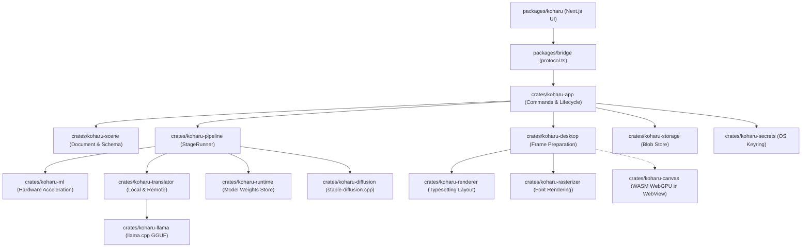
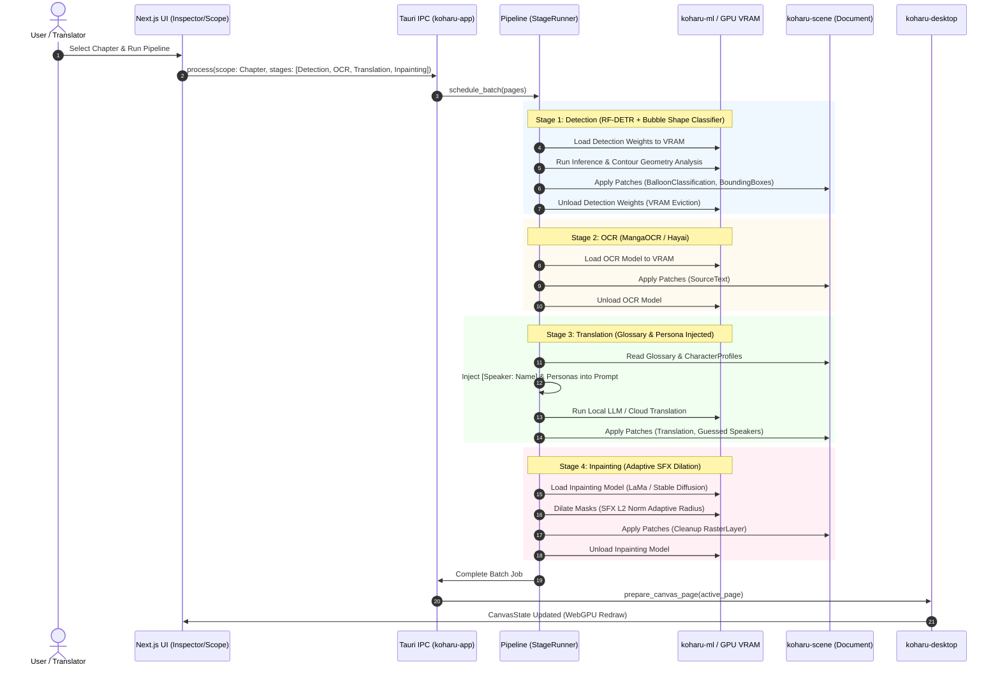

# GEMINI_CONTEXT.md: Koharu Architecture & Planning Context

## 1. Snapshot and Reading Guide

- **Schema Version**: `1.0.0`
- **Snapshot ID**: `koharu-61b5421d-dirty-20261026`
- **Generation Timestamp**: `2026-10-26T23:05:00+07:00`
- **Scope**: Entire repository workspace root (`c:\Users\T3R0\koharu`)
- **Effective Settings**: `detail=standard`, `budget=12000_tokens`, `verification=none`, `appendices=none`, `overwrite=authorized`
- **Git State**:
  - **Branch**: `feature/chapter-workflow-and-detection` [FACT: `git branch --show-current`]
  - **Base Commit**: `61b5421d9959ec2096d345cc406fe90f3aecbbd7` [FACT: `git rev-parse HEAD`]
  - **Commit Subject**: `feat(chapter): complete chapter batch workflow, glossary sync, and stage vram eviction` [FACT: `git log -1`]
  - **Tree State**: `DIRTY` (47 modified files, 2 untracked files) [FACT: `git status -s`]
- **Analysis Depth**: Standard architectural inspection across the Rust native engine, ML processing pipeline, Next.js frontend, and WebGPU presentation layer.
- **Verification Policy**: No compilation, linting, or test execution was initiated during this export [FACT: default safe protocol].
- **Sanitization Summary**: Redacted zero secrets. No credential material, private keys, or API tokens were found in the inspected tree.
- **Snapshot-Not-Live Warning**: This document represents a frozen snapshot of repository structure and code state. External planning agents must treat code claims as bounded by this snapshot and perform live workspace checks before applying alterations.

### Source Manifest

| Relative Path | Role | SHA-256 (Raw Bytes) | Line Count | Selection Reason |
| --- | --- | --- | ---: | --- |
| `Cargo.toml` | Workspace Manifest | `B929C7EA2B77CAA78C7BE703FE57E7CC8FBC7980E72C69C6CB4320442C4DD7BB` | 205 | Rust workspace configuration, member crates, and dependency versions |
| `package.json` | Monorepo Root | `ECEA660E2164D2D859AECB41BD31162791FBE79D1ABD07A8EE5D1AB511D49278` | 36 | Node/Bun workspaces, tooling scripts, and frontend dependencies |
| `crates/koharu/src/main.rs` | Desktop Entry Point | `E357186332E8EFAB48CC107D715BF2AF745BD7C9B45DF178601431204F45D29E` | 47 | Tauri bootstrap, console attachment, logging, and runtime entry |
| `crates/koharu-app/src/lib.rs` | App Engine Root | `5AE801958C706511C54ACE74103621F3EB247216E61D861919EBB2A2CA1E209A` | 7 | Public surface for Tauri commands and CEF application loop |
| `crates/koharu-app/src/app.rs` | Runtime Lifecycle | `6627644AD4C4996C4928E57125EB5F3F92365591391C340BE2A6AFAB0B790639` | 295 | Pipeline initialization, CEF remote debugging configuration, window management |
| `crates/koharu-app/src/commands/mod.rs` | IPC Protocol Bindings | `A3AF99094C00E2EF697E93CD284324D6FB52188BCB77B1C457D15EE9960CE2ED` | 139 | Registration of Specta-generated Tauri command endpoints |
| `crates/koharu-app/src/commands/editing.rs` | Document Mutation RPC | `DF43045DD93DD2B850B91846A91292036BA9CA3014D2FB37F54459B98D4DFBA1` | 469 | Layer, speaker, balloon shape, and chapter transaction commands |
| `crates/koharu-app/src/commands/glossary/rpc.rs` | Glossary & Persona RPC | `3870E937A1A53443CC1A426BD21D19D4A5CD86488EA556883E03A85600FE38C3` | 785 | Glossary management, persona profiles, classification, and translation RPC |
| `crates/koharu-app/src/commands/project.rs` | Project & Trash RPC | `408351F63BE4C9B17FD0984C653C73F55DC99B192E8F080D50FED267164B8A60` | 2011 | Project library, page lifecycle, serialization, and trash management |
| `crates/koharu-scene/src/lib.rs` | Scene Kernel Root | `31D4250D3165CD9339C63744C0330CEFB622309AA3598FA4C61DC79D0666354D` | 51 | Document model definitions, components, re-exports |
| `crates/koharu-scene/src/document.rs` | Document & Page Model | `F680FC3889C8F79953B5EAE6F295FE23A45F896BC429E42D714DEA4A384967A7` | 316 | Entity hierarchy, page accessors, and layer references |
| `crates/koharu-scene/src/schema.rs` | Schema Invariants | `E926EE567EAAF60DC259347F0E70E11DD03950DA41A830E5AC6AB57EF3504B62` | 356 | Component bitmask validation and structural invariants |
| `crates/koharu-scene/src/components/character.rs` | Character Persona Domain | `88193112D73847AA564648ED9C235BBB33BCFDB3CFEC62859460DC852EBF2DD0` | 95 | CharacterProfile, Gender, and Speaker component definitions |
| `crates/koharu-scene/src/components/analysis.rs` | Balloon & Region Domain | `629EA7FA3A70DE7517027122EEFB1C9DFA396868136F4302948D435979FB2F62` | 211 | BalloonShape, BalloonClassification, OCR and detection models |
| `crates/koharu-pipeline/src/pipeline.rs` | Pipeline Orchestrator | `6A61A2952122EB43BF67CBB67B85F857536B13305096988A4BE75C37F11C049E` | 104 | Multi-stage image processing orchestration |
| `crates/koharu-pipeline/src/stages/detection.rs` | Layout & Bubble Stage | `13F9B17E05A3CEBC07F99C462BC18950E6381BD72E8E971D0472991FA5D53C6E` | 3086 | Text/bubble detection, contour geometry, and shape classification |
| `crates/koharu-pipeline/src/stages/translation.rs` | Translation Stage | `CD6A40B2778D0E158FE92A3471892A78183B2303EC5D7140E1C733D31C0E104E` | 404 | Prompt assembly, speaker tagging, persona injection, LLM calling |
| `crates/koharu-pipeline/src/stages/inpainting.rs` | Inpainting Stage | `52A4F940C76D71AFC4384D7D62E4BFB01E2409C17FA2394FED848CF70DF3E9A4` | 1404 | Text removal, LaMa/SD inpainting, adaptive SFX mask dilation |
| `crates/koharu-translator/src/onomatopoeia.rs` | SFX Translation Domain | `2ED7D5B1A8D182E8E099F11E3D5A0537F4B9303D2E711A3A232BEF3929718B25` | 174 | Japanese onomatopoeia lookup dictionary for SFX translation |
| `crates/koharu-renderer/src/config.rs` | Typesetting Presets | `196D5F7331984A34A5214A8295AA4CC6CA22E6751AF75F45101D6700E7F61219` | 107 | BalloonShape font/style pairing rules and configuration loader |
| `packages/bridge/src/protocol.ts` | Frontend IPC Interface | `D5EDC9A7C2B3CB8C21BFA2061CA380E7E0899D82FFCA04AE2F15A22ADB09475F` | 715 | Generated TypeScript API declarations and data contract types |
| `packages/koharu/app/(app)/page.tsx` | Main Application View | `90DEE68F7D8B688D1B8330E95F19DDF6166FFC6683491A30BE3047ED7C8A666F` | 5 | Next.js App Router root mounting the main workspace |
| `packages/koharu/components/editor/GlossaryPanel.tsx` | Persona & Glossary UI | `6C1083A2D5A0AA3549C78DE5C7DF6133D2CF2DE4097CCA95665D87B84C65EB34` | 759 | UI for managing terms, persona profiles, scanning, and classification |
| `packages/koharu/components/editor/Inspector.tsx` | Layer & Typesetting UI | `4CCA1E228DB154A62CEE947E3F15C2A5022E056318345C776CB6CBACD4EF2F24` | 1312 | Inspector panel for text, geometry, typography, speaker, and balloon shape |

---

## 2. Project Overview and Technology Matrix

Koharu is an offline-first desktop application designed for manga translation, typesetting, machine-learning assisted text detection, OCR, inpainting, and chapter-level publishing workflows [DOCUMENTED: `README.md#L1-L15`, `Cargo.toml#L9`].

### Technology Provenance Matrix

| Subsystem | Declared Technology | Resolved Version / Dependency | Runtime / Execution Model |
| --- | --- | --- | --- |
| **Desktop Shell** | Tauri v2 + Chromium Embedded Framework (CEF) | `tauri 2.0.0-rc`, `tauri-runtime-cef` [FACT: `Cargo.toml#L24-L25`] | Native Windows/Linux executable with CEF remote debugging at `127.0.0.1:4000` [FACT: `crates/koharu-app/src/app.rs#L71-L74`] |
| **Frontend UI** | Next.js 16 (App Router) + React 19 + Tailwind CSS v4 | `next ^16.3.8`, `react ^19.3.0`, `@tailwindcss/postcss ^4.3.3` [FACT: `packages/koharu/package.json#L27-L49`] | Client-side rendered Single-Page App loaded inside CEF WebView [FACT: `packages/koharu/next.config.ts`] |
| **State & Data Fetching** | Zustand + TanStack Query v5 | `zustand ^5.0.15`, `@tanstack/react-query ^5.104.0` [FACT: `packages/koharu/package.json#L17-L35`] | In-memory reactive state synchronized with Rust host via revisioned RPC [FACT: `packages/koharu/lib/store.ts#L50-L80`] |
| **Type-Safe Bridge** | Specta v2 + Tauri Specta | `specta =2.0.0-rc.25`, `tauri-specta` [FACT: `Cargo.toml#L60`, `crates/koharu-app/Cargo.toml#L45-L56`] | Code-generated TypeScript contracts written to `packages/bridge/src/protocol.ts` [FACT: `crates/koharu-app/src/bin/generate.rs`] |
| **Canvas Presentation** | Rust WASM + WebGPU | `koharu-canvas` (`wasm32-unknown-unknown`), WebGPU surface [FACT: `crates/koharu-canvas/src/lib.rs#L1-L15`] | Browser WebGPU canvas rendering frames prepared by native `koharu-desktop` [FACT: `crates/koharu-desktop/src/lib.rs#L1-L60`] |
| **Document State Kernel** | Revisioned Entity-Component System | `koharu-scene`, `revision 0.7.1` [FACT: `crates/koharu-scene/Cargo.toml`] | Immutable snapshots, transactional atomic patches, monotonic revisions [FACT: `crates/koharu-scene/src/document.rs`] |
| **ML Inference Pipeline** | Tokio + LibTorch + ONNX + llama.cpp + stable-diffusion.cpp | `koharu-ml`, `koharu-pipeline`, `koharu-llama-sys`, `koharu-diffusion-sys` [FACT: `Cargo.toml#L27-L38`] | Multiprocess / threadpool hardware acceleration (CUDA, Vulkan, DirectML, Metal, CPU) [FACT: `crates/koharu-ml/src/backend.rs`] |
| **Translation Engine** | Offline GGUF + Remote API Providers | Local GGUF catalog, Claude, DeepL, DeepSeek, Gemini, OpenAI, Grok, OpenRouter [FACT: `crates/koharu-translator/src/remote/mod.rs`] | Local inference via `koharu-llama` or authenticated HTTPS requests with keys from OS keyring [FACT: `crates/koharu-secrets/src/lib.rs`] |
| **Project Storage** | Atomic Filesystem + Binary Blobs | `koharu-storage`, `blake3`, `tokio::fs` [FACT: `crates/koharu-storage/src/blobs.rs`] | Content-addressed blob store with transactional manifest indexing [FACT: `crates/koharu-app/src/commands/project.rs#L328-L478`] |

---

## 3. Filtered Directory Tree and Module Map

```
koharu/
├── .agents/                        # Specialized agent instructions and skills
├── .cargo/                         # Cargo configuration and build flags
├── .github/                        # CI/CD workflows and sponsorship automation
├── agyim/                          # AGY change request work orders and implementation logs
├── crates/                         # Rust workspace members
│   ├── koharu/                     # Desktop binary entry point (tracing, sentry, app launch)
│   ├── koharu-agent/               # Autonomous LLM translation agent integrations
│   ├── koharu-app/                 # Tauri commands, project lifecycle, IPC handlers, trash management
│   ├── koharu-bindgen/             # Code generation binary producing TypeScript bindings
│   ├── koharu-canvas/              # WASM WebGPU canvas rendering engine for browser presentation
│   ├── koharu-config/              # Shared TOML configuration loader and watcher
│   ├── koharu-desktop/             # Native page frame preparation and presentation coordinator
│   ├── koharu-diffusion/          # High-level wrapper for Stable Diffusion inpainting models
│   ├── koharu-diffusion-sys/      # Native C/C++ FFI bindings to stable-diffusion.cpp
│   ├── koharu-llama/              # High-level wrapper for local GGUF translation models
│   ├── koharu-llama-sys/          # Native C/C++ FFI bindings to llama.cpp
│   ├── koharu-metrics/            # Sentry telemetry and performance timing layers
│   ├── koharu-ml/                 # ML compute backend abstraction (CUDA, DirectML, Vulkan, CPU)
│   ├── koharu-pipeline/           # Multi-stage image processing pipeline (Detect, OCR, Translate, Inpaint)
│   ├── koharu-psd/                # Adobe Photoshop PSD export and import engine
│   ├── koharu-rasterizer/         # Native text rasterization and vector rendering engine
│   ├── koharu-renderer/           # Typesetting layout engine and balloon-shape preset pairing
│   ├── koharu-runtime/            # Model weights downloader, cache, and variable store
│   ├── koharu-scene/              # Core document kernel, ECS entities, components, patches, schema
│   ├── koharu-secrets/            # Operating system keychain storage using secrecy crate
│   ├── koharu-storage/            # Project storage engine, content-addressed blobs, transactions
│   ├── koharu-torch/              # PyTorch / LibTorch tensor abstractions
│   ├── koharu-torch-sys/          # FFI bindings to LibTorch C++ API
│   └── koharu-translator/         # Translation abstractions, onomatopoeia dictionary, remote providers
├── packages/                       # Monorepo TypeScript packages
│   ├── bridge/                    # Auto-generated Tauri IPC protocol contracts and canvas client
│   ├── docs/                      # Documentation site
│   ├── koharu/                    # Main Next.js desktop web application
│   └── ui/                        # Reusable React UI component library (Tailwind CSS)
├── scripts/                        # Operational scripts and toolchain helpers
├── Cargo.toml                      # Workspace Cargo manifest
├── package.json                    # Workspace Bun/Node manifest
└── AGENTS.md                       # Repository-wide development and architectural rules
```

*Omitted Directories: `target/` (Cargo build artifacts), `node_modules/` (Node dependencies), `.next/` (Next.js build cache), `out/` (Static frontend export), `.git/` (Version control database).*

---

## 4. Current Architecture and Boundaries

### Architectural Tiers & Flow

```
[ Next.js 16 UI (@koharu/app) ]
           │
           │  Direct IPC (Tauri Specta / @koharu/bridge)
           ▼
[ Host Application Commands (koharu-app) ]
    ├── Project & Trash Lifecycle (koharu-storage)
    ├── Scene Kernel & Transactions (koharu-scene)
    ├── Processing Orchestrator (koharu-pipeline)
    │     ├── Stage 1: Detection (RF-DETR / YOLOv8 / YOLO11)
    │     ├── Stage 2: OCR (MangaOCR / PaddleOCR / Hayai)
    │     ├── Stage 3: Translation (Local llama.cpp / Cloud APIs)
    │     └── Stage 4: Inpainting (LaMa / Stable Diffusion)
    └── Frame Preparation & Rasterization (koharu-desktop & koharu-renderer)
           │
           ▼
[ Presentation Surface: WASM WebGPU Canvas (koharu-canvas) in CEF WebView ]
```

### Trust & Security Boundaries

1. **Local-Only Runtime Boundary**: All core processing (OCR, Detection, Inpainting, Document Storage) runs entirely local to the user machine by default [FACT: `crates/koharu-pipeline/src/pipeline.rs#L30-L75`].
2. **Secrets Boundary**: API tokens for third-party cloud translation (OpenAI, Anthropic, DeepL, Google Cloud) are never stored in plain text configuration files. They are encrypted in the operating system secure keyring via `koharu-secrets` and zeroized on drop [FACT: `crates/koharu-secrets/src/lib.rs#L1-L45`].
3. **CEF Debugging Boundary**: The CEF remote debugging port `4000` is strictly bound to `127.0.0.1` and compiled only under `debug_assertions` [FACT: `crates/koharu-app/src/app.rs#L70-L74`, `AGENTS.md#L62-L66`].
4. **Document Revision Boundary**: Every mutation command requires an `expectedRevision` parameter. Conflicting writes are aborted before committing to prevent out-of-order state corruption [FACT: `crates/koharu-app/src/commands/editing.rs#L15-L35`].

---

## 5. Architecture and Runtime Diagrams

### Component Dependency Architecture



### Chapter Batch Execution & Stage VRAM Eviction Sequence



*(Note: Diagrams reviewed for structural clarity; not validated with an external parser).*

---

## 6. Data Models, State, and Business Invariants

### Core Scene Graph Hierarchy

The document model in `crates/koharu-scene` operates as a strict transactional hierarchy [FACT: `crates/koharu-scene/src/document.rs#L1-L150`]:

```
Project (Root Entity)
  └── Page (Entity)
        ├── TextGroup (Container Entity)
        │     ├── TextLayer (Dialogue / Narration / SFX)
        │     │     ├── SourceText Component
        │     │     ├── Translation Component
        │     │     ├── Typography Component
        │     │     ├── Geometry Component
        │     │     ├── Speaker Component [NEW]
        │     │     └── BalloonClassification Component [NEW]
        │     └── ...
        └── RasterLayer (Artwork / Inpainting Cleanup)
```

### Component Invariants and Bitmask Constraints

Defined in `crates/koharu-scene/src/schema.rs#L45-L67`:

| Bit Index | Component Name | Struct Type | Owning Entity | Validations & Constraints |
| ---: | --- | --- | --- | --- |
| `0` | `PROJECT` | `Project` | Root | Must be unique per document session |
| `1` | `PAGE` | `Page` | Page | Contains page ordering and dimensions |
| `2` | `GROUP` | `Group` | Layer Group | Container for child layer entities |
| `3` | `TEXT_GROUP` | `TextGroup` | Group | Special container designated for text layers |
| `4` | `GEOMETRY` | `Geometry` | Layer / Region | Polygon vertices; must be finite coordinates [FACT: `analysis.rs#L40-L50`] |
| `5` | `RASTER_LAYER` | `RasterLayer` | Raster Layer | Associated image blob identifier and raster kind |
| `7` | `SOURCE_TEXT` | `SourceText` | Text Layer | Extracted text from OCR or user entry |
| `11` | `TRANSLATION` | `Translation` | Text Layer | Target translated text string |
| `13` | `TYPOGRAPHY` | `Typography` | Text Layer | Font family, size, line spacing, stroke, alignment |
| `18` | `GLOSSARY` | `Glossary` | **Project Only** | Must be owned by Project root; invalid on pages/layers [FACT: `schema.rs#L70-L75`] |
| `19` | `SPEAKER` | `Speaker` | Text Layer | References a `GlossaryEntryId` of kind Person [FACT: `character.rs#L52-L95`] |
| `20` | `BALLOON_CLASSIFICATION` | `BalloonClassification` | Text Layer | Contains `BalloonShape` and confidence [0.0..=1.0] [FACT: `analysis.rs#L184-L211`] |

### New Domain Types: Character Persona & Balloon Classification

1. **`CharacterProfile`** (`crates/koharu-scene/src/components/character.rs#L22-L50`):
   - `id`: `GlossaryEntryId`
   - `gender`: `CharacterGender` (`Unspecified`, `Male`, `Female`, `NonBinary`)
   - `first_person`: `Option<String>` (max 128 characters)
   - `second_person`: `Option<String>` (max 128 characters)
   - `tone`: `Option<String>` (max 256 characters)
   - `custom_instructions`: `Option<String>` (max 2048 characters)
2. **`BalloonShape`** (`crates/koharu-scene/src/components/analysis.rs#L173-L182`):
   - Values: `NormalSpeech`, `Shout`, `Thought`, `Whisper`, `Narration`.
3. **`TrashItem`** (`crates/koharu-app/src/commands/project.rs#L43-L52`):
   - `id`: `String` (UUID v4)
   - `kind`: `TrashKind` (`Page`, `Folder`, `FolderWithPages`)
   - `name`: `String`
   - `pages`: `Vec<TrashPageRecord>`

---

## 7. API Contracts and External Integrations

All IPC calls are strongly typed across Tauri Specta and exported to `packages/bridge/src/protocol.ts` [FACT: `crates/koharu-app/src/commands/mod.rs#L56-L139`].

### Key Tauri IPC Endpoints

| Command Name | Parameters | Return Type | Category |
| --- | --- | --- | --- |
| `get_project` | None | `ProjectResponse` | Lifecycle |
| `process` | `request: ProcessingRequest` | `()` | Pipeline Execution |
| `stop_job` | `job: String` | `()` | Job Cancellation |
| `unload_pipeline_models` | None | `()` | VRAM Cleanup |
| `set_bubble_speaker` | `expectedRevision: Revision, layer: EntityId, speaker: GlossaryEntryId?` | `()` | Persona / Typesetting |
| `guess_page_speakers` | `expectedRevision: Revision, page: EntityId` | `()` | Persona Automated Guess |
| `set_balloon_shape` | `expectedRevision: Revision, layer: EntityId, shape: BalloonShape?` | `()` | Shape Typesetting |
| `set_page_chapter` | `expectedRevision: Revision, page: EntityId, chapter: String?` | `()` | Chapter Workflow |
| `update_character_profile` | `expectedRevision: Revision, entryId: GlossaryEntryId, profile: CharacterProfile` | `()` | Glossary Persona |
| `get_trash_items` | None | `TrashItem[]` | Trash Management |
| `restore_trash_item` | `id: String` | `()` | Trash Restoration |
| `delete_trash_item` | `id: String` | `()` | Permanent Trash Deletion |
| `clear_trash` | None | `()` | Empty Trash Store |
| `export_chapter` | `chapter: String, config: ExportConfig` | `ExportResult` | Chapter Publishing |

### External Translation Integrations

Managed in `crates/koharu-translator`:
- **Local Provider**: `crates/koharu-llama` loading GGUF checkpoints from Hugging Face or user local paths.
- **Cloud Providers**: Claude (`anthropic.com`), DeepL (`deepl.com`), DeepSeek (`deepseek.com`), Gemini (`generativelanguage.googleapis.com`), OpenAI (`openai.com`), Grok (`x.ai`), OpenRouter (`openrouter.ai`). Keys are fetched on demand from the OS keychain [FACT: `crates/koharu-secrets/src/lib.rs`].

---

## 8. UI, UX, and User Journeys

### UI Architecture (`packages/koharu`)

- **Root Routing**: Built with Next.js 16 App Router. `app/(app)/page.tsx` mounts the desktop editing canvas [FACT: `packages/koharu/app/(app)/page.tsx#L1-L5`].
- **State Flow**:
  - Global UI state (tools, active selections, brush size, zoom) is managed in `packages/koharu/lib/store.ts` via Zustand.
  - Document entities and glossary data are cached and queried via TanStack Query in `packages/koharu/lib/queries.ts`.
- **Key UI Surfaces**:
  - `GlossaryPanel.tsx` (`packages/koharu/components/editor/GlossaryPanel.tsx`): Manages project glossary entries, classification (Character vs Term), persona parameters (first person pronouns, tone, instructions), and batch AI term extraction.
  - `Inspector.tsx` (`packages/koharu/components/editor/Inspector.tsx`): Displays properties for the selected text layer: source text, translation, speaker selector, balloon shape selector, font family, size, line spacing, stroke, and orientation.
  - `TypesettingPreferences.tsx` (`packages/koharu/components/preferences/TypesettingPreferences.tsx`): Allows translators to configure default font pairings for each balloon shape (`NormalSpeech` -> CCWildWords, `Shout` -> Bold sans, `Thought` -> Italic, `Whisper` -> Light font) [FACT: `crates/koharu-renderer/src/config.rs#L50-L106`].
- **Localization**: Handled by `i18next` with locales in `public/locales/` covering `en-US`, `ja-JP`, `zh-CN`, `zh-TW`, `ko-KR`, `es-ES`, `pt-BR`, `ru-RU`, and `tr-TR` [FACT: `packages/koharu/public/locales/`].

---

## 9. Critical Source Code and Entry Points

### 1. Shape Classification Heuristic

`crates/koharu-pipeline/src/stages/detection.rs#L1611-L1649`:
```rust
pub fn classify_balloon_shape(geometry: &Geometry, bbox: [f32; 4]) -> (BalloonShape, f32) {
    let points = &geometry.points;
    if points.len() < 3 {
        return (BalloonShape::NormalSpeech, 0.5);
    }
    let area = polygon_area(points);
    let perimeter = polygon_perimeter(points);
    if area <= 0.0 || perimeter <= 0.0 {
        return (BalloonShape::NormalSpeech, 0.5);
    }
    let circularity = (4.0 * std::f64::consts::PI * area) / (perimeter * perimeter);
    let bbox_width = (bbox[2] - bbox[0]).max(1.0) as f64;
    let bbox_height = (bbox[3] - bbox[1]).max(1.0) as f64;
    let bbox_area = bbox_width * bbox_height;
    let rectangularity = area / bbox_area;
    let hull = convex_hull(points);
    let hull_area = polygon_area(&hull);
    let solidity = if hull_area > 0.0 { area / hull_area } else { 1.0 };

    if rectangularity >= 0.88 {
        let confidence = (rectangularity as f32).clamp(0.7, 0.99);
        return (BalloonShape::Narration, confidence);
    }
    if solidity < 0.85 || circularity < 0.55 {
        let confidence = ((1.0 - circularity).max(1.0 - solidity) as f32).clamp(0.65, 0.99);
        return (BalloonShape::Shout, confidence);
    }
    if solidity < 0.92 && circularity < 0.72 {
        return (BalloonShape::Thought, 0.80);
    }
    let confidence = (circularity as f32).clamp(0.75, 0.99);
    (BalloonShape::NormalSpeech, confidence)
}
```

### 2. Persona Injection & Speaker Tagging in Translation

`crates/koharu-pipeline/src/stages/translation.rs#L67-L74`, `L152-L173`:
```rust
        // Speaker tagging prefix for prompt
        let segments = targets.iter().map(|(_, _, source, speaker, _)| {
            if self.config.enable_speaker_tagging
                && let Some(speaker_id) = speaker
                && let Some(name) = speaker_names.get(speaker_id)
            {
                format!("[Speaker: {name}] {source}")
            } else {
                source.clone()
            }
        }).collect::<Vec<_>>();

        // Persona formatting
        if self.config.enable_personas && !person_entries.is_empty() {
            let mut personas = Vec::new();
            for entry in &person_entries {
                let name = entry.translation.as_deref().unwrap_or(entry.source.as_str()).trim();
                let mut parts = vec![format!("- Character: {name} (Source: {})", entry.source.trim())];
                if let Some(profile) = &entry.character {
                    if profile.gender != CharacterGender::Unspecified {
                        parts.push(format!("Gender: {:?}", profile.gender));
                    }
                    if let Some(first) = &profile.first_person {
                        parts.push(format!("1st-person: {first}"));
                    }
                    if let Some(tone) = &profile.tone {
                        parts.push(format!("Tone: {tone}"));
                    }
                }
                personas.push(parts.join(" | "));
            }
        }
```

### 3. Adaptive Morphological SFX Mask Dilation

`crates/koharu-pipeline/src/stages/inpainting.rs#L571-L584`:
```rust
        if let Ok(mut layers) = group.text_layers() {
            let has_sfx = layers.any(|l| {
                l.content()
                    .ok()
                    .flatten()
                    .and_then(|c| c.role().ok().flatten())
                    .is_some_and(|r| r.role == "dev.koharu.text.sfx")
            });
            if has_sfx && mask.width() > 0 && mask.height() > 0 {
                let sfx_radius = ((mask.width().max(mask.height()) as f32 / 1024.0) * 3.0)
                    .round()
                    .clamp(1.0, 16.0) as u8;
                mask = dilate(&mask, Norm::L2, sfx_radius);
                text_mask = dilate(&text_mask, Norm::L2, sfx_radius);
            }
        }
```

---

## 10. Environment and Configuration Reference

Configured through `crates/koharu-config` reading `.koharu/config.toml` from the user profile directory [FACT: `crates/koharu-config/src/lib.rs#L34-L36`].

| Variable / Section | Purpose | Scope | Required / Optional | Default Value | Evidence |
| --- | --- | --- | --- | --- | --- |
| `[pipeline]` | ML model selection and device preferences | Engine | Optional | Defaults to auto GPU detection | `crates/koharu-pipeline/src/config.rs` |
| `[typesetting]` | Font pairings and balloon shape styling | Renderer | Optional | `CCWildWords`, `Adobe 黑体 Std` | `crates/koharu-renderer/src/config.rs#L28-L42` |
| `TAURI_DEBUG` | Remote debugging flag | Shell | Optional | Port 4000 under debug | `crates/koharu-app/src/app.rs#L71` |
| `SENTRY_DSN` | Telemetry crash reporting endpoint | App Root | Optional | Empty / Disabled in local debug | `crates/koharu/src/main.rs#L30` |

---

## 11. Infrastructure and Operations

- **Build Toolchain**:
  - Rust 2024 edition via Cargo [FACT: `Cargo.toml#L8`].
  - Bun workspace orchestrator for frontend packages [FACT: `package.json#L3-L5`].
  - `cargo tauri build --no-bundle` for standard application compilation [FACT: `package.json#L11`].
- **CI / CD Pipelines**: Located in `.github/workflows/`:
  - `build.yml`: Multi-platform compilation for Windows (MSVC), Linux (glibc/Vulkan), and macOS (Apple Silicon).
  - `lint.yml`: Cargo check, clippy, and oxlint validation.
- **Runtime Model Distribution**: Model weights (ONNX, GGUF, SafeTensors) are downloaded dynamically on first use from Hugging Face Hub into `~/.cache/koharu/models/` by `crates/koharu-runtime` [FACT: `crates/koharu-runtime/src/download.rs`].

---

## 12. Project Rules and Change Constraints

From `AGENTS.md` and repository standards:

1. **Zero Backward Compatibility**: When an API, schema, configuration, or ownership boundary changes, update every in-repository consumer and remove the replaced form immediately. Never write backward-compatibility parsers, aliases, or forwarding shims [FACT: `AGENTS.md#L6-L10`].
2. **Zero AI Slop**: Strict KISS/YAGNI. No defensive empty catches, no comments narrating obvious syntax, no speculative abstractions [FACT: `user_global`].
3. **ML Architecture**: Separate network ownership and weight loading from preprocessing, postprocessing, slicing, and result types. Disable gradient tracking during inference. Accept a device abstraction at the boundary [FACT: `AGENTS.md#L18-L26`].
4. **Desktop UI & CEF Debugging**: Debug builds must expose the CEF remote debugging endpoint at `http://127.0.0.1:4000`. Connect `chrome-devtools-mcp` with `--browser-url=http://127.0.0.1:4000` for WebView automation [FACT: `AGENTS.md#L48-L54`].
5. **Presentation Separation**: Canvas pixels are presented through the `koharu-canvas` WASM module and WebGPU inside the standard Tauri webview. Keep durable scene preparation native, transient canvas interactions in the browser [FACT: `AGENTS.md#L56-L60`].
6. **Verification Discipline**: Optimize for fast development and iteration. Run the smallest relevant check or focused test once using the debug profile. Do not run full test suites unless requested [FACT: `AGENTS.md#L42-L46`].

---

## 13. Commands, Tests, and Verification Baseline

| Command | Working Directory | Source | Prerequisites | Side Effects | Status |
| --- | --- | --- | --- | --- | --- |
| `cargo check --workspace` | `.` | `Cargo.toml` | Rust toolchain, C++ build tools | Generates `target/` metadata | `CONFIGURED_NOT_RUN` |
| `cargo test -p koharu-scene` | `.` | `Cargo.toml` | Rust toolchain | Compiles and runs scene tests | `CONFIGURED_NOT_RUN` |
| `cargo test -p koharu-pipeline` | `.` | `Cargo.toml` | Rust toolchain | Compiles and runs pipeline unit tests | `CONFIGURED_NOT_RUN` |
| `bun run --filter @koharu/app test` | `.` | `package.json` | Bun installed | Runs Vitest unit tests | `CONFIGURED_NOT_RUN` |
| `bun run --filter @koharu/app lint` | `.` | `package.json` | Bun installed | Runs oxlint checks | `CONFIGURED_NOT_RUN` |
| `oxfmt --check packages tests package.json` | `.` | `package.json` | oxfmt installed | Checks formatting | `CONFIGURED_NOT_RUN` |
| `cargo run --bin koharu-bindgen` | `.` | `crates/koharu-bindgen` | Rust toolchain | Regenerates `protocol.ts` | `CONFIGURED_NOT_RUN` |

*(Verification policy: Verification was not authorized by the user for this snapshot export; all statuses remain `CONFIGURED_NOT_RUN`).*

---

## 14. Current Status, Risks, and Technical Debt

### Active In-Flight Work

Work order `AGY-CR-20261026-MANGA-SUITE-001` has modified 47 files across the workspace [FACT: `git status -s`]:
- **Phase 1 (Character & Persona Memory)**: Implemented in `crates/koharu-scene`, `crates/koharu-pipeline`, `crates/koharu-app`, and `packages/koharu`. Allows translators to assign speakers and character personas that persist into LLM translation prompts.
- **Phase 2 (Smart Typesetting & Bubble-Shape Font Pairing)**: Shape classification heuristic implemented in `detection.rs`; typesetting presets implemented in `koharu-renderer`.
- **Phase 3 (SFX Pipeline & Stylized Calligraphy)**: Onomatopoeia table added in `koharu-translator`; adaptive morphological dilation added in `inpainting.rs`.

### Known Risks & Technical Debt

1. **Uncommitted Working Tree**: The current working tree contains 47 modified files and 2 untracked files (`character.rs`, `onomatopoeia.rs`). Any prospective plan must branch from or incorporate these uncommitted edits [FACT: `git status -s`].
2. **Local LLM Context Window Constraints**: Prepending lengthy persona descriptions and multi-page translation context into small GGUF models (e.g. 7B/8B models with 4k context) risks context truncation if chapters contain dense dialogue [INFERENCE: based on `crates/koharu-pipeline/src/stages/translation.rs#L143-L173`].
3. **WASM WebGPU Platform Support**: WebGPU canvas rendering in CEF requires hardware acceleration enabled and proper Vulkan/DirectX drivers on the host machine [FACT: `crates/koharu-app/src/app.rs#L76-L82`].

---

## 15. Planning and Change-Impact Map

| Change Topic | Likely Affected Files | Key Interfaces / Contracts | Impacted Verification |
| --- | --- | --- | --- |
| **New ML Detection Model** | `crates/koharu-ml/src/`, `crates/koharu-pipeline/src/stages/detection.rs` | `DetectionAnalysis`, `BalloonClassification`, `KoharuLayoutMask` | `cargo test -p koharu-pipeline` |
| **New Translation Provider** | `crates/koharu-translator/src/remote/`, `crates/koharu-translator/src/backend.rs` | `Translator` trait, `TranslationRequest`, `TranslationContext` | `cargo test -p koharu-translator` |
| **Document Schema Modification** | `crates/koharu-scene/src/schema.rs`, `components.rs`, `document.rs` | `component_schema!`, `Component` trait, `Snapshot`, `Patch` | `cargo test -p koharu-scene`, `cargo run --bin koharu-bindgen` |
| **Editor UI Feature** | `packages/koharu/components/editor/`, `packages/koharu/lib/store.ts` | `@koharu/bridge/protocol.ts`, Zustand state slices | `bun run --filter @koharu/app test` |
| **Typesetting & Font Rule Update** | `crates/koharu-renderer/src/config.rs`, `crates/koharu-renderer/src/layout.rs` | `TypesettingConfig`, `TypesettingPreset`, `BalloonShape` | `cargo test -p koharu-renderer` |
| **Trash & Page Management** | `crates/koharu-app/src/commands/project.rs`, `editing.rs` | `TrashItem`, `TrashKind`, `read_trash_items` | `cargo test -p koharu-app` |

---

## 16. Unknowns, Coverage, and Export Review

### Coverage Limits

- **Deeply Inspected**: Workspace root manifests, `crates/koharu-app`, `crates/koharu-scene`, `crates/koharu-pipeline`, `crates/koharu-renderer`, `crates/koharu-translator`, and `packages/bridge`.
- **Inventory Only**: C/C++ FFI bindings in `crates/koharu-llama-sys` and `crates/koharu-diffusion-sys`; individual neural network weights and tensor shapes in `crates/koharu-ml`.
- **Estimated Size**: Approximately 8,500 tokens (well within the 12,000 token budget).

### Key Unknowns for Planners

1. *Has the current uncommitted state in `AGY-CR-20261026-MANGA-SUITE-001` undergone full integration testing under the debug CEF profile?* [UNKNOWN]
2. *Are the default onomatopoeia translations in `crates/koharu-translator/src/onomatopoeia.rs` intended to be user-customizable via the UI in a future phase?* [UNKNOWN]
3. *What is the target minimum VRAM threshold for running the full 4-stage pipeline sequentially on end-user hardware?* [UNKNOWN]

### Human Review Checklist Before External Sharing

- [ ] Confirm no proprietary manga text, private API tokens, or test credentials reside in uncommitted files.
- [ ] Confirm the snapshot reflects the desired base commit `61b5421d` and branch `feature/chapter-workflow-and-detection`.
- [ ] Verify that external planners understand that `GEMINI_CONTEXT.md` is an immutable snapshot, not a dynamic live connection to the codebase.
