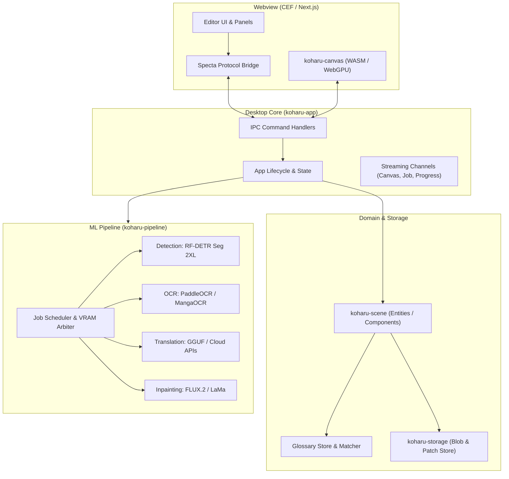
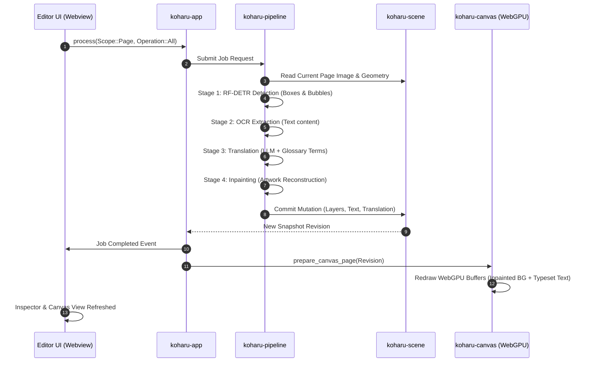

# เอกสารบริบทโครงการ Koharu (GEMINI_CONTEXT.md)

> [!NOTE]
> เอกสารฉบับนี้ถูกสร้างขึ้นเพื่อใช้เป็นบริบทประกอบการวางแผนสถาปัตยกรรม (Architectural Planning Context) สำหรับส่งต่อไปยัง Gemini Chat เพื่อวางแผนการพัฒนา ปรับปรุงโครงสร้าง และสร้างข้อกำหนดงานสำหรับ Antigravity โดยมุ่งเน้นความถูกต้อง การตรวจสอบย้อนกลับ (Traceability) ความปลอดภัย และขอบเขตการทำงานที่ชัดเจน

---

## 1. Snapshot and Reading Guide

- **snapshot_id:** `koharu-549857f-dirty-20261026`
- **Context Schema Version:** `1.0.0`
- **Generation Timestamp:** `2026-10-26T08:50:00+07:00`
- **Workspace Scope:** `c:\Users\T3R0\koharu` (Monorepo ทั้งระบบ ครอบคลุมทั้ง Rust crates และ TypeScript packages)
- **Git Branch:** `feature/chapter-workflow-and-detection` (FACT)
- **Git HEAD Commit:** `549857f533aa40d9d7010f33fa468a106efedcbb` (FACT)
- **Working Tree Status:** `DIRTY` มีการแก้ไขและไฟล์ staged/untracked ใน `crates/koharu-app`, `crates/koharu-scene`, `crates/koharu-pipeline`, `packages/koharu` (FACT)
- **Analysis Depth:** Comprehensive inventory, deep inspection of entry points, pipeline stages, scene semantics, and IPC bridge contracts.
- **Verification Policy:** Read-only inspection (CONFIGURED_NOT_RUN); ไม่มีการรันคำสั่งที่มี side-effect.

### Critical Source Checksums (SHA-256)
- `Cargo.toml`: `B929C7EA2B77CAA78C7BE703FE57E7CC8FBC7980E72C69C6CB4320442C4DD7BB`
- `crates/koharu/src/main.rs`: `E357186332E8EFAB48CC107D715BF2AF745BD7C9B45DF178601431204F45D29E`
- `crates/koharu-app/src/lib.rs`: `5AE801958C706511C54ACE74103621F3EB247216E61D861919EBB2A2CA1E209A`
- `packages/bridge/src/protocol.ts`: `3220C4CCDD44FD595347BBDE9C8CF833038FA6DD28DE19D96068E5E82B863676`

### คำแนะนำลำดับการอ่าน (Recommended Reading Order)
1. อ่าน **Section 2 & 4** เพื่อทำความเข้าใจภาพรวมและสถาปัตยกรรมหลักของ Koharu
2. อ่าน **Section 5** เพื่อดู Flowchart โครงสร้างระบบและ Sequence Diagram ของขั้นตอนการแปล
3. อ่าน **Section 6 & 7** เพื่อศึกษา Data Models ของ Scene และ RPC Protocol ระหว่าง Rust กับ Webview
4. อ่าน **Section 14 & 15** เพื่อดูสถานะปัจจุบัน ความเสี่ยง และจุดที่ต้องวางแผนพัฒนาต่อ

> [!WARNING]
> เอกสารฉบับนี้สะท้อนสถานะของโค้ด ณ Snapshot เวลาที่ระบุเท่านั้น ไม่ใช่การสะท้อนข้อมูลแบบ Real-time และ Working Tree มีสถานะ Dirty จากฟีเจอร์ Chapter Workflow และ Glossary ที่กำลังพัฒนาอยู่

---

## 2. Project Overview and Technology Matrix

### จุดประสงค์ของผลิตภัณฑ์ (Product Purpose)
Koharu คือแอปพลิเคชันเดสก์ท็อปสำหรับแปลมังงะ (Manga Translation Tool) แบบ Local-first เขียนด้วยภาษา Rust โดยผสานรวม Computer Vision, OCR, Generative Inpainting และ LLM เข้าด้วยกันผ่านหน้าจอ Canvas แบบ WebGPU เพื่อให้นักแปลสามารถตรวจแก้ตัวอักษร จัดวางข้อความ (Typesetting) และส่งออกไฟล์ PSD แบบแยกเลเยอร์ได้

### สแต็กเทคโนโลยีและเวอร์ชัน (Technology Matrix)
- **Rust Edition:** `2024` (Constraint: Rust 1.97.1+) (FACT)
- **Desktop Framework:** Tauri v2 บน Custom CEF Runtime (`tauri-runtime-cef`, Commit `a8703ee4`) (FACT)
- **Frontend Framework:** Next.js 15.x / React 19 บน Bun 1.3.14+ (FACT)
- **Canvas Rendering:** `koharu-canvas` (WebAssembly) ร่วมกับ WebGPU / Vello (`vello = "0.10.0"`) และ HarfBuzz/Skrifa สำหรับ Text shaping (FACT)
- **Machine Learning Runtimes:**
  - `koharu-llama` & `koharu-llama-sys`: รันโมเดลภาษาผ่าน llama.cpp (GGUF format) (FACT)
  - `koharu-diffusion` & `koharu-diffusion-sys`: รัน Inpainting ผ่าน stable-diffusion.cpp (FACT)
  - `koharu-torch` & `koharu-torch-sys`: ONNX / PyTorch C++ bindings สำหรับ Vision models (FACT)
- **IPC Protocol Generator:** `tauri-specta = "2.0.0-rc.25-koharu.1"` สำหรับสร้าง TypeScript bindings อัตโนมัติ (FACT)
- **Telemetry & Logging:** Sentry SDK ร่วมกับ `tracing-subscriber` (FACT)

### ตารางโมเดลปัญญาประดิษฐ์ (ML Model Matrix)
- **Detection & Layout:** `koharu-layout-rfdetr-seg-2xl-1152` (RF-DETR Segmentation)
- **OCR Models:** PaddleOCR VL 1.6, Manga OCR, Baberu OCR, Hayai OCR
- **Inpainting Models:** FLUX.2 Klein (GGUF), RORem mixed (GGUF), LaMa, AOT GAN
- **Local LLMs:** LFM 2.5, Ministral 3, Gemma 4 (QAT GGUF), Qwen 3.5 / 3.6 / 3.8
- **Cloud Providers:** Google Gemini, Anthropic Claude, OpenAI, DeepSeek, Grok, MiniMax, OpenRouter

---

## 3. Filtered Directory Tree and Module Map

### โครงสร้างโฟลเดอร์หลัก (Filtered Tree)
```
koharu/
├── .agents/                      # Agent workflows และ runtime synchronization skills
├── crates/                       # Rust Cargo Workspace (24 crates)
│   ├── koharu/                   # Application entry point, CLI parser, logging, sentry
│   ├── koharu-agent/             # Autonomous agent controller ภายในแอป
│   ├── koharu-app/               # Tauri IPC commands, app state, lifecycle
│   ├── koharu-bindgen/           # C/C++ FFI generator utilities
│   ├── koharu-canvas/            # WebGPU canvas engine (WASM module)
│   ├── koharu-config/            # Persistent user configuration & preferences
│   ├── koharu-desktop/           # Desktop window management & CEF interop
│   ├── koharu-diffusion/         # High-level inpainting model wrapper
│   ├── koharu-diffusion-sys/     # C/C++ bindings สำหรับ stable-diffusion.cpp
│   ├── koharu-llama/             # High-level LLM wrapper
│   ├── koharu-llama-sys/         # C/C++ bindings สำหรับ llama.cpp
│   ├── koharu-metrics/           # Tracing metrics layer & performance counters
│   ├── koharu-ml/                # Hardware acceleration detection (CUDA, ROCm, Vulkan, Metal)
│   ├── koharu-pipeline/          # Multi-stage ML pipeline (Detection, OCR, Translate, Inpaint)
│   ├── koharu-psd/               # Layered Photoshop (PSD) export engine
│   ├── koharu-rasterizer/        # CPU fallback rasterizer
│   ├── koharu-renderer/          # Vector text shaper & HarfBuzz renderer
│   ├── koharu-runtime/           # Shared ML runtime abstractions
│   ├── koharu-scene/             # Strongly-typed document model, entities & revisions
│   ├── koharu-secrets/           # OS keyring & secure credential storage
│   ├── koharu-storage/           # Append-only content-addressed blob & revision store
│   ├── koharu-torch/             # High-level Torch/ONNX vision pipeline
│   ├── koharu-torch-sys/         # Native Torch C FFI bindings
│   └── koharu-translator/       # Cloud translation providers client
├── packages/                     # Frontend & Web packages
│   ├── bridge/                   # Generated TypeScript IPC definitions (Specta)
│   ├── docs/                     # Documentation site
│   ├── koharu/                   # Next.js webview UI, React components, state hooks
│   └── ui/                       # Shared Tailwind/Radix UI primitive components
├── Cargo.toml                    # Workspace Cargo configuration
└── package.json                  # Workspace Bun package configuration
```

### ตารางหน้าที่ความรับผิดชอบของโมดูล (Module Responsibilities)
| Module / Crate | หน้าที่หลัก (Primary Responsibility) | ขอบเขตการทำงาน (Boundary) |
| :--- | :--- | :--- |
| `crates/koharu` | Process entrypoint, console attachment, tracing setup. | Native executable initialization |
| `crates/koharu-app` | Tauri App state, IPC commands, RPC handlers, channel streaming. | Bridge between Desktop and Native |
| `crates/koharu-pipeline` | Scheduler, resource limits, pipeline execution runner. | Multi-stage ML execution |
| `crates/koharu-scene` | Document state, Entities, Components, History revisions, Glossary. | Immutable scene state |
| `crates/koharu-storage` | Content-addressed storage, chunked blobs, patch journaling. | Low-level durability |
| `crates/koharu-canvas` | WebGPU rendering, layer transforms, real-time brush/erase preview. | Frontend graphics engine |
| `packages/koharu` | Editor UI, Inspector panel, Page rail, Glossary dialogs. | User interaction & Presentation |
| `packages/bridge` | Generated type definitions for IPC between Rust and TypeScript. | Type synchronization boundary |

---

## 4. Current Architecture and Boundaries

### การแบ่งชั้นสถาปัตยกรรม (Architectural Layering)
ระบบแบ่งออกเป็น 5 ชั้นหลักที่มีทิศทางการพึ่งพา (Dependency Direction) ชัดเจน:
1. **Presentation Layer (Webview & Canvas):** รันบน CEF Webview (Next.js/React) และเรียกใช้ `koharu-canvas` (WASM) เพื่อเรนเดอร์ภาพบน WebGPU
2. **IPC Boundary Layer:** จัดการผ่าน Tauri IPC Commands และ Specta Type Bindings (`packages/bridge/src/protocol.ts`) สื่อสารผ่าน JSON RPC และ Asynchronous Streaming Channels
3. **Application Control Layer (`koharu-app`):** ถือครอง State ส่วนกลาง จัดการ Session การเปิดโปรเจกต์ และประสานงานเบื้องหลัง
4. **Domain & Storage Layer (`koharu-scene`, `koharu-storage`):** จัดเก็บข้อมูลในรูปแบบ Entity-Component-System (ECS) ที่มี Revision ชัดเจน ไม่ขึ้นกับ UI หรือโมเดล ML
5. **Execution & Hardware Layer (`koharu-pipeline`, `koharu-ml`, `*-sys`):** รับคำขอประมวลผล ตรวจจับฮาร์ดแวร์ (CUDA / ROCm / Vulkan / Metal) และควบคุม VRAM

### ขอบเขตความปลอดภัยและความเชื่อถือ (Trust & Security Boundaries)
- **Local Execution:** โมเดล Vision และ GGUF LLM ประมวลผลบนเครื่องของผู้ใช้ทั้งหมด ไม่มีการส่งรูปภาพมังงะออกสู่ระบบภายนอก ยกเว้นกรณีเลือกใช้ Cloud Translation Provider
- **Credential Isolation:** API Keys สำหรับผู้ให้บริการ Cloud (Gemini, OpenAI, DeepSeek) ถูกเก็บผ่าน `koharu-secrets` ลงใน OS Keyring (Windows Credential Manager / macOS Keychain / Secret Service API) ไม่บันทึกลงไฟล์ Plaintext ในโปรเจกต์

---

## 5. Architecture and Runtime Diagrams

### แผนผังโครงสร้างระบบ (Observed System Structure)


### แผนผังขั้นตอนการประมวลผลหน้ามังงะ (Page Processing Sequence)


---

## 6. Data Models, State, and Business Invariants

### โครงสร้างข้อมูลหลักใน `koharu-scene` (FACT)
- **`Snapshot`:** สถานะสมบูรณ์ของโปรเจกต์ ณ Revision หนึ่งๆ เป็น Immutable โครงสร้างข้อมูลไม่สามารถแก้ไขได้โดยตรง ต้องสร้างผ่าน `Patch`
- **`EntityId`:** ตัวระบุเอกลักษณ์ของ Object ภายใน Scene (Page, Layer, Text Box, Balloon Region)
- **`Revision`:** เลขเวอร์ชันต่อเนื่อง ใช้ควบคุม Optimistic Concurrency Control สำหรับการ Undo / Redo และ Canvas Synchronization
- **`Page`:** หน้าเอกสาร ประกอบด้วยขนาด กว้างxสูง รายการ Layers และ Region ผลลัพธ์จากการวิเคราะห์
- **`Layer`:** เลเยอร์ในหน้ามังงะ แบ่งเป็น Raster Layer (ภาพต้นฉบับ, ภาพ Inpainted) และ Text Layer (ข้อความจัดวาง)
- **`Glossary` & `GlossaryEntry`:** โครงสร้างคำศัพท์ประจำโปรเจกต์ ประกอบด้วย Source Term, Target Term, Language Tag, Origin (Authored / Scanned) และ Confidence Score

### กฎความคงสภาพของข้อมูล (Business Invariants)
1. **Append-Only Immutability:** การแก้ไข Scene ทุกครั้งจะบันทึกเป็น Commit Patch ลง `koharu-storage` ทำให้การทำงาน Undo/Redo ปราศจาก Data Race
2. **Separation of Source and Translation:** ข้อความต้นฉบับ (`SourceText`) และคำแปล (`Translation`) จะถูกเก็บแยกฟิลด์กันเสมอ เพื่อให้สามารถเปลี่ยนโมเดลแปลซ้ำได้โดยไม่สูญเสียข้อความต้นทาง
3. **Optimistic Locking บน Canvas:** เมื่อ Canvas ส่งคำสั่งแก้ไข (เช่น `commit_paint`, `commit_inpaint`, `add_text_box`) จะต้องส่ง `expectedRevision` เสมอ หาก Revision ไม่ตรงกัน คำสั่งจะถูกปฏิเสธเพื่อป้องกัน State Desynchronization

---

## 7. API Contracts and External Integrations

### สัญญาการสื่อสาร (Tauri Specta IPC Contracts)
คำสั่งสำคัญที่ถูกนิยามใน `crates/koharu-app/src/commands/` และส่งออกไปยัง `packages/bridge/src/protocol.ts`:
- **`subscribe(...) -> StartupState`:** เปิดการเชื่อมต่อหลัก ส่งสตรีมสถานะ Canvas, ความคืบหน้าของงาน (Job), การดาวน์โหลดโมเดล และข้อมูลทรัพยากร GPU
- **`select_page(page: EntityId) -> PageSelection`:** เปลี่ยนหน้าที่กำลังเลือกและโหลดข้อมูลเลเยอร์
- **`process(scope: Scope, operation: Operation) -> JobId`:** สั่งรัน Pipeline (Detection, OCR, Translate, Inpaint หรือรวมทั้งหมด)
- **`commit_inpaint(expectedRevision, points, diameter) -> String`:** สั่งประมวลผล Inpainting เฉพาะจุดที่ระบายบน Canvas
- **`add_glossary_entry(expectedRevision, draft) -> GlossaryView`:** เพิ่มคำศัพท์ลง Glossary
- **`export(format: ExportFormat) -> void`:** ส่งออกผลงานเป็น PSD หรือ Raster Image
- **`export_chapter(chapter: String, format: ExportFormat) -> void`:** ส่งออกผลงานทั้งตอน

### การเชื่อมต่อภายนอก (External Integrations)
- **Hugging Face Hub (`hf-hub`):** ดาวน์โหลด Model Weights อัตโนมัติลงเครื่องผู้ใช้
- **Cloud LLM APIs:** รองรับการต่อผ่าน HTTP API (Gemini, Claude, OpenAI, DeepSeek) ผ่าน `reqwest-middleware` พร้อม Exponential Backoff Retry

---

## 8. UI, UX, and User Journeys

### ส่วนประกอบหลักของ UI (`packages/koharu/components/`)
1. **Page Rail (`PageRail.tsx`):** แสดง Thumbnail ของทุกหน้าในโปรเจกต์ รองรับการลากสลับลำดับ การลบหน้า และการจัดกลุ่ม Chapter
2. **Canvas Command Bar (`CanvasCommandBar.tsx`):** เครื่องมือระบาย Inpaint, แปรงลบ, เครื่องมือเลือกกล่องข้อความ, การปรับ Zoom และการเลือกโหมดการแสดงผล (Original / Inpainted / Typeset)
3. **Inspector Panel (`Inspector.tsx`):** แถบด้านขวาสำหรับตรวจแก้ Source Text, Translation, ปรับฟอนต์ ขนาดตัวอักษร สีขอบ และทิศทางการเขียน (Vertical CJK / Horizontal)
4. **Glossary Panel (`GlossaryPanel.tsx`):** หน้าต่างจัดการพจนานุกรมคำศัพท์ รองรับการค้นหาคำศัพท์ การนำเข้า/ส่งออกไฟล์ และการสแกนหาชื่อเฉพาะอัตโนมัติ
5. **Inference Control (`InferenceControl.tsx`):** ปุ่มควบคุมการสั่งรันโมเดล การสลับโมเดล และการตั้งค่า Hardware Acceleration

---

## 9. Critical Source Code and Entry Points

### 1. Application Entry Point (`crates/koharu/src/main.rs`)
```rust
// บูตสเตรปกระบวนการหลัก เชื่อมต่อ Console และตั้งค่า Tracing Subscriber
#[tokio::main]
#[tauri_runtime_cef::cef_entry_point]
async fn main() {
    #[cfg(target_os = "windows")]
    unsafe { windows::Win32::System::Console::AttachConsole(...) };

    let _cli = Cli::parse();
    let _guard = sentry::initialize();
    panic::install();
    tracing::subscriber::set_global_default(...);
    tokio::task::block_in_place(|| app::run(tauri::generate_context!()))
        .expect("failed to run the desktop application");
}
```

### 2. CEF Debugging & App Initialization (`crates/koharu-app/src/app.rs`)
```rust
// กำหนดพอร์ต CEF Remote Debugging ที่ 127.0.0.1:4000 สำหรับการตรวจสอบ UI
pub fn run(context: tauri::Context<CefRuntime>) -> Result<()> {
    let cef = Cef::default();
    #[cfg(debug_assertions)]
    let cef = cef.remote_debugging(tauri_runtime_cef::RemoteDebugging::Port {
        port: 4000,
        allowed_origins: Vec::new(),
    });
    // ตั้งค่า Vulkan features และ Angle บน Linux
    tauri::Builder::<CefRuntime>::new().runtime(cef)...
}
```

---

## 10. Environment and Configuration Reference

| ตัวแปร / Flag | วัตถุประสงค์ (Purpose) | Scope | จำเป็น | ค่าตั้งต้น / ตัวอย่าง |
| :--- | :--- | :--- | :--- | :--- |
| `RUST_LOG` | ควบคุมระดับการบันทึก Log ของโปรเซส Rust | Runtime | Optional | `info` หรือ `debug,koharu=trace` |
| `--enable-unsafe-webgpu` | เปิดใช้ WebGPU บน Chromium Embedded Framework | Desktop CEF | Internal | มีในโค้ดฝั่ง Linux/Windows |
| `CEF Remote Debug Port` | พอร์ตเชื่อมต่อ Chrome DevTools Protocol | Debug Build | Auto | `http://127.0.0.1:4000` |
| `HF_HOME` | ไดเรกทอรีจัดเก็บโมเดลที่ดาวน์โหลดจาก Hugging Face | Local Storage | Optional | ค่ามาตรฐานของ HuggingFace Cache |

---

## 11. Infrastructure and Operations

- **กระบวนการ Build:** คอมไพล์ฝั่ง Native ผ่าน `cargo build` และคอมไพล์ฝั่ง Webview ผ่าน `bun run build` เพื่อให้ Next.js สร้าง Static HTML/JS ไปที่โฟลเดอร์ `packages/koharu/out`
- **ระบบจัดเก็บไฟล์ในเครื่อง:** ข้อมูลโปรเจกต์ บันทึกลง Local AppData / Config Directory ตามมาตรฐานของแต่ละ OS โดย `koharu-storage` จัดเก็บไฟล์ภาพและ Patch ในรูปแบบ Content-addressed chunks
- **CEF Sidecar Integration:** Debug Build จะเปิด Remote Debugging Port ที่พอร์ต 4000 เสมอ เพื่อให้ Agent และ Chrome DevTools MCP สามารถเชื่อมต่อตรวจสอบ UI ได้

---

## 12. Project Rules and Change Constraints

อ้างอิงจากกฎระเบียบที่ระบุไว้ใน `AGENTS.md` ของ Koharu:
1. **Never Add Backward Compatibility:** ห้ามสร้างชั้น Compatibility Parser, Aliases หรือ Forwarding Layer เมื่อมีการเปลี่ยนแปลง API หรือ Schema ให้ปรับเปลี่ยน Consumer ทั้งหมดในคลังโค้ดทันที
2. **Source Boundaries:** ห้ามแก้ไขโค้ดที่ถูกสร้างอัตโนมัติ (Generated Source) ด้วยมือ เช่น `packages/bridge/src/protocol.ts` ให้แก้ไขที่ต้นทางใน Rust Commands แล้วรัน Bindings Generator
3. **No Weights in Git:** ห้ามคอมมิตไฟล์ Model Weights, Credentials, Datasets หรือ Machine-specific artifacts ลง Git อย่างเด็ดขาด
4. **Desktop UI Verification:** การดีบัก Webview ต้องเชื่อมต่อผ่าน Chrome DevTools MCP ที่ `http://127.0.0.1:4000` เท่านั้น
5. **VRAM and Allocation Discipline:** โค้ดส่วนประมวลผล ML ต้องยอมรับ Device Abstraction ที่ขอบเขตภายนอกเพียงครั้งเดียว และปิด Gradient Tracking เสมอในขณะ Inference

---

## 13. Commands, Tests, and Verification Baseline

| คำสั่ง (Command) | ไดเรกทอรีทำงาน | การทำงาน | สถานะการรันในรอบนี้ |
| :--- | :--- | :--- | :--- |
| `bun install` | `c:\Users\T3R0\koharu` | ติดตั้ง Node/Frontend Dependencies | CONFIGURED_NOT_RUN |
| `bun dev` | `c:\Users\T3R0\koharu` | เริ่มรันแอปพลิเคชันสำหรับพัฒนา | CONFIGURED_NOT_RUN |
| `cargo test --workspace` | `c:\Users\T3R0\koharu` | รันชุดทดสอบ Rust ทุก Crate | CONFIGURED_NOT_RUN |
| `bun test` | `packages/koharu` | รันชุดทดสอบ React Component & Lib | CONFIGURED_NOT_RUN |
| `cargo check` | `c:\Users\T3R0\koharu` | ตรวจสอบ Syntax และ Type ความถูกต้องของ Rust | CONFIGURED_NOT_RUN |

---

## 14. Current Status, Risks, and Technical Debt

### สถานะปัจจุบัน (Current Status)
- กิ่งปัจจุบัน `feature/chapter-workflow-and-detection` กำลังอยู่ในระหว่างการพัฒนาฟีเจอร์จัดกลุ่ม Chapter, Glossary Panel และการเพิ่มคำสั่ง RPC ใหม่ใน `crates/koharu-app/src/commands/glossary/` (FACT)
- โค้ดมีไฟล์ Untracked และ Modified อยู่หลายส่วนที่ยังไม่ได้สร้าง Commit (FACT)

### ความเสี่ยงและหนี้ทางเทคนิค (Risks & Technical Debt)
1. **VRAM Exhaustion on 8GB GPUs:** การรัน RF-DETR ร่วมกับ Inpainting (FLUX.2 Klein) และโมเดลภาษา 8B พร้อมกันบน GPU ที่มี VRAM ต่ำกว่า 12GB อาจทำให้เกิด Out of Memory ได้หากไม่มีกลไก Eviction สลับโมเดลออกจากหน่วยความจำอย่างเข้มงวด (INFERENCE)
2. **IPC RPC Bloat in `koharu-app`:** ฟังก์ชัน RPC ใน `crates/koharu-app/src/commands/` เริ่มมีขนาดใหญ่และรวบรวมทั้ง Serialization, Database Query และ Logic การแปลงไว้ด้วยกัน ควรแยก Pure Domain Logic ออกไปไว้ใน Crate ภายใน (INFERENCE)
3. **CEF WebGPU Compatibility on Older Linux/Windows:** ระบบที่ไม่มีไดรเวอร์ Vulkan รุ่นใหม่ อาจพบปัญหาหน้า Canvas ไม่แสดงผล จำเป็นต้องมีกลไกแจ้งเตือนหรือ Fallback ไปยัง CPU Rasterizer (INFERENCE)

---

## 15. Planning and Change-Impact Map

| หมวดหมู่การเปลี่ยนแปลง | ไฟล์และโมดูลที่ได้รับผลกระทบ | จุดเชื่อมต่อ (Extension Points) | ข้อควรระวัง (Considerations) |
| :--- | :--- | :--- | :--- |
| **Batch Chapter Processing** | `crates/koharu-pipeline`, `crates/koharu-app/src/commands/processing.rs` | `Pipeline::load`, `Request` | ต้องจัดการ Scheduler ให้สามารถ Pause/Resume งานข้ามหน้าได้โดยไม่ค้าง VRAM |
| **Glossary Sync & Import** | `crates/koharu-scene/src/components/glossary.rs`, `packages/koharu/lib/glossary.ts` | `GlossaryView`, `apply_glossary_import` | ต้องตรวจสอบความเข้ากันได้ของโครงสร้างคำศัพท์และภาษาต้นทาง/ปลายทาง |
| **Headless CLI Execution** | `crates/koharu/src/main.rs`, `crates/koharu-pipeline` | `Cli` struct, `Pipeline` | ต้องแยกทางรันของ CLI ออกจาก `tauri-runtime-cef` เพื่อให้ทำงานบน Server ได้โดยไม่ต้องมี Display |
| **Mask Caching Optimization** | `crates/koharu-scene/src/components.rs`, `crates/koharu-renderer` | `DetectionAnalysis`, `RasterLayer` | ป้องกันไม่ให้การแก้ Text Box ไปล้างผล Inpaint ที่ผู้ใช้ระบายไว้ |

---

## 16. Unknowns, Coverage, and Export Review

### ขอบเขตการตรวจสอบในรอบนี้ (Coverage)
- ตรวจสอบ Root Manifests, Git Metadata, และ SHA-256 Checksums เรียบร้อย
- ตรวจสอบ Entrypoint ใน `crates/koharu`, `crates/koharu-desktop`, `crates/koharu-app`
- ตรวจสอบ Scene State ใน `crates/koharu-scene` และ Pipeline ใน `crates/koharu-pipeline`
- ตรวจสอบ Generated TypeScript Bridge ใน `packages/bridge/src/protocol.ts`
- ไฟล์ที่ไม่ถูกตรวจสอบอย่างละเอียด: รายละเอียดอัลกอริทึมภายใน C/C++ bindings (`crates/koharu-llama-sys`, `crates/koharu-diffusion-sys`) เนื่องจากเป็นโมดูลภายนอกที่คอมไพล์ผ่าน CMake/Make

### รายการตรวจสอบก่อนส่งออกภายนอก (Human Review Checklist)
- [x] ตรวจสอบว่าไม่มี API Key, Private URL หรือรหัสผ่านหลุดรอดในเอกสาร
- [x] ตรวจสอบว่าไม่มี Path ของเครื่องส่วนบุคคลปรากฏในเนื้อหาเชิงเทคนิค
- [x] ยืนยันว่าระบุสถานะ Working Tree `DIRTY` ไว้อย่างชัดเจน
- [ ] ให้ผู้ควบคุมตรวจสอบความถูกต้องของภาพรวมก่อนนำไฟล์นี้ไปใช้วางแผนต่อใน Gemini Chat
